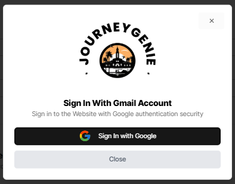
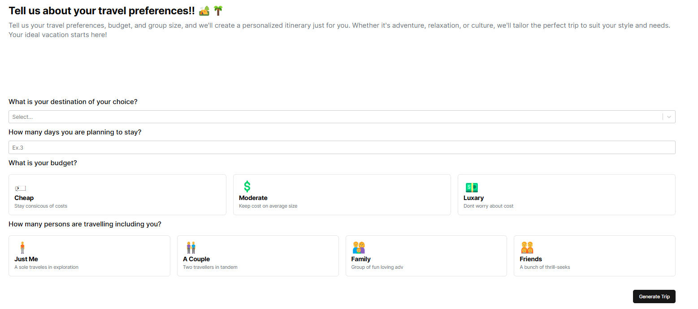
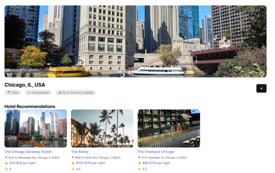
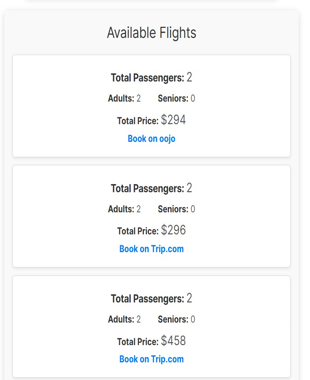
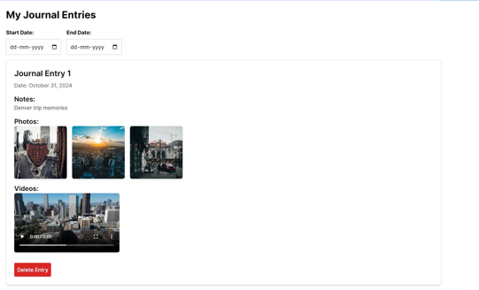

# JourneyGenie

- JourneyGenie is a sophisticated AI-powered trip planning platform that streamlines the travel experience by offering personalized recommendations, seamless flight and hotel booking, and intuitive trip journaling. With the integration of external APIs and a user-friendly design, JourneyGenie is designed to cater to the needs of modern travelers, ensuring ease of use and accessibility. 
- 

## Project Photos
- Landing page
- 

- Google Authentication
- 

- Trip generation page
- 

- Result after generating the trip for Chicago city
- 

- Flight search feature
- 

- Journal entries for keeping a track of different trips
- 


## Prerequisites

Before getting started, make sure you have the following installed:

- [Node.js](https://nodejs.org/) (version 12 or higher)
- [npm](https://www.npmjs.com/) (comes with Node.js)

## How to Run the Website Locally

Follow these steps to set up and run the JourneyGenie website on your local machine.

### 1. Clone the Repository

First, clone the repository from the main branch using the following command:

```bash
git clone https://github.com/NandishDPatel/JourneyGenie.git
```

### 2. Navigate to the Project Folder

Change into the `JourneyGenie` directory on your local machine:

```bash
cd JourneyGenie
```

### 3. Install Dependencies

Run the following command to install the necessary npm packages and dependencies:

```bash
npm install
```

### 4. Run the Node Proxy Server

Start the Node.js proxy server by running the following command:

```bash
node proxy-server.js
```

### 5. Start the Development Server

In a new terminal go inside the JourneyGenie project folder and then run the following command to launch the frontend development server:

```bash
npm run dev
```

The website should now be running locally and accessible at `http://localhost:5173`.

## Additional Information

- Make sure to configure these 3 environment variables in the new file inside the JourneyGenie folder named as .env.local and set these 3 variables values for successfully running the project:
- 
  ```bash
  - VITE_GOOGLE_PLACE_API_KEY = 
  - VITE_GOOGLE_GEMINI_TRIP_API_KEY=
  - VITE_GOOGLE_AUTH_CLIENT_ID=
  ```
  
- Need to put Google Place API by using google cloud website: https://console.cloud.google.com/marketplace/product/google/places-backend.googleapis.com?q=search&referrer=search&project=notifyhub-442711

- Need to use the website https://aistudio.google.com/prompts/new_chat?_gl=1*nwqe4g*_ga*MTAxNzMzNTk4OC4xNzM3NzUzMTE5*_ga_P1DBVKWT6V*MTczNzc1MzExOS4xLjAuMTczNzc1MzExOS42MC4wLjY0MDkyMjg3Mg.. for Gemini Trip Api Key
- Use your google client id for creating the valid google authenticator of Gmail for logging in and saving your trips to Firebase

- Also have to place your VITE_GOOGLE_PLACE_API_KEY inside the proxy-server.js file where it is written like googleAPIKEY="-".

- And then the project will be up and running:)
